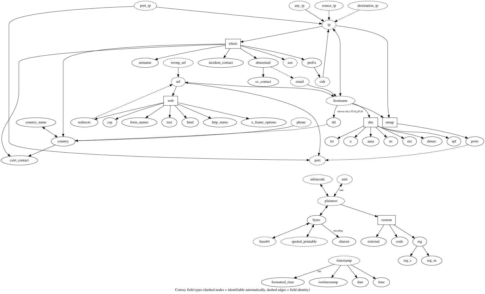

# Computing fields

Convey knows a few dozen field types (`ip`, `hostname`, `base64`, `country`…) and the methods converting one to another. When you ask for a field, convey finds the shortest path from the input type to the requested one and chains the methods. Ex: `hostname → ip → whois → country`.

## Field syntax

The `--field, -f` (and `--field-excluded, -fe`) flag has the following syntax:

> *FIELD[[CUSTOM]],[COLUMN],[SOURCE_TYPE],[CUSTOM],[CUSTOM]*

* **FIELD** – the field type to compute, see the [reference](#field-reference) below. It may be followed by a CUSTOM part in square brackets.
* **COLUMN** – which column to compute from: its position (`1`, `2`…, or `-1` from the right), its exact name, or a field type. When omitted, convey picks a suitable column itself.
* **SOURCE_TYPE** – how to treat the source column. Use it to prevent the implicit conversion, ex: take a base64 string as a `plaintext` and not decode it first.
* **CUSTOM** – the parameters of the field, if it needs any (ex: a regular expression). When not given, you are asked at runtime (or the default is used with `--yes`).

Any part may be skipped by an empty value, ex: `tld,,,gTLD` is the same as `tld[gTLD]`.

| Example | Meaning |
|---------|---------|
| `-f country` | add country, computed from whatever column suits |
| `-f country,2` | add country computed from the second column |
| `-f netname,ip` | add netname computed from the column containing an IP |
| `-f tld[gTLD]` | add TLD, filtered by the CUSTOM option `gTLD` |
| `-f reg_s,"ll","LL"` | substitute `ll` by `LL` (two CUSTOM parts) |
| `-f reg_s,1,plaintext,"[A-Z]","!"` | the same on the first column, treated as a plain text |
| `-f code,"x=x[1:5]"` | custom Python code |
| `-f external,/tmp/myfile.py,any_method` | [external](external-fields.md) Python function |

See the [single value](../single-value.md#picking-fields) page for a walkthrough with outputs.

## Field reference

### General

* **base64** – text encoded with Base64
* **charset** – decode the text in a charset of your choice
* **cidr** – CIDR notation, ex: `127.0.0.1/32`
* **country_name** – country name from a country code (and vice versa)
* **date**, **time**, **isotimestamp**, **formatted_time** – parts of a timestamp; `formatted_time` asks for a format
* **email** – e-mail address
* **hostname** – domain name, ex: from a URL
* **ip** – IP address, ex: translated from a hostname
* **plaintext** – plain text
* **port** – port
* **quoted_printable** – text encoded as quoted-printable
* **tld** – top level domain; asks whether to take any TLD, `gTLD` or `ccTLD`
* **unit** – any physical quantity, converted by [pint](https://pint.readthedocs.io/); asks for the target unit
* **url** – URL starting with http/https
* **urlencode** – text encoded with urlencode

### Custom

* **code** – your Python code, the variable `x` holds the value: `-f code,"x=x.upper()"`
* **external** – a function from your own `.py` file, see [external fields](external-fields.md)
* **reg** – regular expression wizard
* **reg_m** – match from a regular expression
* **reg_s** – substitution by a regular expression

### Whois

* **abusemail** – abuse e-mail contact from whois
* **asn** – autonomous system number
* **cc_contact** – e-mail address corresponding with the abusemail, taken from your personal contacts CSV in the format `domain,cc;cc` (mails delimited by a semicolon). Path to this file is in the `sending.contacts_cc` [option](../configuration.md).
* **country** – country code from whois
* **csirt_contact** – e-mail address corresponding with the country code, taken from your personal contacts CSV in the format `country,abusemail`. Path to this file is in the `sending.contacts_abroad` option.
* **incident_contact** – if the IP comes from the local country (the `whois.local_country` option), the field gets *abusemail*, otherwise we get *country@@mail* where *mail* is either the *csirt_contact* or the *abusemail*. When splitting by this field, convey is subsequently able to [send](../sending-files.md) the split files to local abuse and foreign CSIRT contacts.
* **netname** – network name
* **prefix** – IP range the record belongs to
* **registrar_abusemail** – abuse e-mail contact of the domain registrar

### DNS

Needs the `dig` program, disabled by default, enable by `--dig`.

* **a**, **aaaa**, **mx**, **ns**, **txt** – DNS records
* **spf** – SPF record
* **dmarc** – DMARC record

### Nmap

Needs the `nmap` program, disabled by default, enable by `--nmap`.

* **ports** – open ports

### Web

Scrapes the page, enable/disable by `--web`.

* **http_status** – HTTP response status (0 or negative if the request failed)
* **text** – page text without tags
* **html** – page HTML source
* **redirects** – URLs the page redirected through
* **csp** – Content-Security-Policy header
* **x_frame_options** – X-Frame-Options header
* **form_names** – names of the form fields

## Detectable fields

Some of the field types are possible to be auto-detected:

* **ip** – standard IPv4 / IPv6 addresses
* **source_ip**, **destination_ip** – an IP in a column named like `source`, `src` or `destination`, `dst`
* **cidr** – CIDR notation, ex: `127.0.0.1/32`
* **port_ip** – IPv4 in the form `1.2.3.4.port`
* **any_ip** – IPv4 garbled in the form `any text 1.2.3.4 any text`
* **port** – port number (only by a column name like `port`)
* **hostname** – or FQDN; 2nd or 3rd domain name
* **url** – URL starting with http/https
* **wrong_url** – URL that has been deactivated by replacing certain chars, ex: `hxxp://example[.]com`
* **email** – e-mail address
* **asn** – AS Number
* **base64** – text encoded with base64
* **quoted_printable** – text encoded as quoted-printable
* **urlencode** – text encoded with urlencode
* **phone** – telephone number
* **timestamp** – time or date
* **unit** – physical quantity, ex: `3 kg`
* **plaintext** – plain text
* **path** – a file path (only by a column name), used to [attach files](../sending-images.md) when sending

When the detection fails, set the type by `--type, -t`, ex: `--type country sc` or, for a CSV, `--type hostname,path` (per column).

## Whois module

When obtaining a WHOIS record

* We ask **RDAP** first – the JSON successor of the port 43 *whois* protocol. gTLD registries are allowed to shut *whois* down (ICANN Registration Data Policy, since 2025-01-28) and the RIRs are heading the same way. Should RDAP not answer (most ccTLDs, ex: `.cz`, have no RDAP) or should the answer be incomplete, we fall back to *whois*. Choose the backend with `--whois.backend auto|rdap|whois`.
* RDAP does not carry the announcing **ASN** (*whois* has it in the `origin:` route object), hence we resolve it over DNS from the Cymru IP-to-ASN zone (needs `dig`; disable with `--whois.asn-lookup False`).
* For *whois*, we are internally calling the `whois` program, detecting what servers were asked.
* Sometimes you encounter a funny formatted *whois* response. We try to mitigate such cases and **re-ask another registry** in well known cases.
* Since IP addresses in the same prefix share the same information we cache it to gain **maximal speed** while reducing *whois* queries. The cache is kept for `--whois.ttl` seconds.
* Sometimes you encounter an IP that gives no information but asserts its prefix includes a large portion of the address space. All IP addresses in that portion end labeled as unknowns. At the end of the processing you are **asked to redo unknowns** one by one to complete missing information, flushing misleading superset from the cache.
* You may easily hit **LACNIC query rate** quota. In that case, we re-queue such lines to be queried after the quota is over if possible. At the end of the processing, you will get asked whether you wish to carefully and slowly reprocess the lines awaiting the quota lift.

## Overview of all methods

Current field computing capacity can be get from the `--show-uml` flag. Generate yours by ex: `convey --show-uml | dot -Tsvg -o /tmp/convey-methods.svg`

* Dashed node: field type is auto-detectable
* Dashed edge: field types are identical
* Edge label: generating options asked at runtime
* Rectangle: field category border

